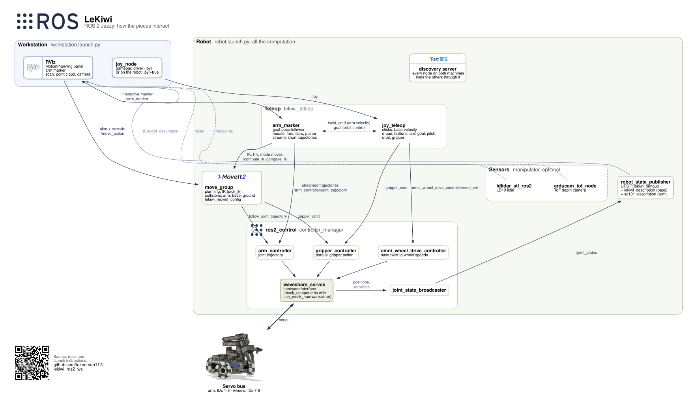

# LeKiwi ROS 2 Workspace

A workspace for using the LeKiwi Low-Cost Mobile Manipulator (an omnidirectional base with an
SO-101 arm) under ROS 2 Jazzy.

## Packages

| Package | What it is |
|---|---|
| `waveshare_servos` | ros2_control hardware interface for the Feetech/Waveshare servo bus |
| `lekiwi_description` | the base: URDF macro, ros2_control joints, base controllers |
| `so101_description` | the arm: URDF macro, ros2_control joints, arm and gripper controllers |
| `lekiwi_bringup` | the combined robot, and the launch files for the robot and the workstation |
| `so101_moveit_config` | MoveIt for the arm on its own (planning groups, IK, controllers) |
| `lekiwi_moveit_config` | MoveIt for the arm on the LeKiwi, with collisions against the base and the ground |
| `lekiwi_teleop` | the RViz marker follower (`arm_marker`) and the joystick teleop (`joy_teleop`) |
| `manipulator` | my robot: the stock LeKiwi plus my sensors (lidar, ToF camera, wrist camera); see [Your own robot](#your-own-robot) |
| `pico_lsm6ds3_ros2` | driver and orientation fusion for the Pico + LSM6DS3 USB IMU; see [IMU](#imu) |

Each package has a README with the details. Third-party drivers: `ldlidar_stl_ros2` (LD19
lidar, submodule in `src/`) and `arducam_rclpy_tof_pointcloud` (Arducam ToF, a symlink into the
`third_party/Arducam_tof_camera` submodule, see `third_party/README.md`). `colcon.meta` holds
per-package build settings (a compile fix for `ldlidar_stl_ros2` on Jazzy); colcon reads it
from the workspace root.

## Robot / workstation split

The robot runs everything that controls the hardware and does all the computation: the servo
driver and controllers, `move_group`, the marker follower and the joystick teleop. The workstation
runs RViz and, usually, the joystick driver. Both must be on the same network, with the same
`ROS_DOMAIN_ID`, and must not share that domain ID with any other ROS system on the network.

```
robot (robot.launch.py)                                     workstation (workstation.launch.py)
  waveshare_servos + controllers  <-- arm / base commands     RViz: MotionPlanning, arm marker
  move_group (planning, IK, collisions)                       joy_node  --- /joy --->  joy_teleop
  arm_marker (marker and joystick arm control)
  joy_teleop (joystick -> base and arm)
```

## Architecture



- **ros2_control** owns the hardware. `waveshare_servos` drives the servo bus, one bus for the
  arm and the wheels. With `use_mock_hardware:=true`, `mock_components` takes its place. With
  `limp:=true` the hardware starts with torque off, and only the joint states run.
- **MoveIt** (`move_group`) never touches the hardware. It plans, solves IK and checks
  collisions, then sends trajectories to the controllers.
- **Teleop** uses MoveIt for IK and for the moves into a mode. While following the marker or the
  joystick, `arm_marker` streams short trajectories straight to `arm_controller`. `joy_teleop`
  drives the base directly, moves the arm through `arm_marker`, and orbits the base around the
  arm's goal.
- **Discovery**: nodes on both machines find each other through the Fast DDS discovery server on
  the robot (see [Docker](#docker-recommended)).

The diagram's source is `docs/architecture.dot`; run `docs/make_architecture.sh` after editing it.

## Docker (recommended)

`docker/` builds two images on the machine that runs them (amd64 or arm64, from the
multi-arch `ros:jazzy-ros-base`), and runs them with host networking and a Fast DDS
discovery server on the robot:

| | Runs |
|---|---|
| `compose.robot.yaml` (robot) | `discovery`: the Fast DDS discovery server on UDP 11811; `robot`: `robot.launch.py`; `mapping`, `localization` (profiles): navigation; `imu` (profile): the IMU validation stack, RViz on the workstation ([IMU](#imu)) |
| `compose.workstation.yaml` (workstation) | `workstation`: `workstation.launch.py` (RViz, joystick driver), connected to the robot's discovery server; `imu` (profile): the IMU validation, no robot; `imu-robot` (profile): RViz for the IMU validation on the robot ([IMU](#imu)) |

The robot's nodes find each other through the server at `127.0.0.1`; the workstation's
through the server at `ROBOT_IP`. The workstation runs as a super client, so RViz and
`ros2` commands see the whole graph. Multicast discovery is not used.

Check out the submodules first (`git submodule update --init`). On each machine, from the
workspace root:

```bash
# robot
docker/setup-env.sh robot                                   # writes docker/.env: ids, devices
docker compose -f docker/compose.robot.yaml up --build -d
docker compose -f docker/compose.robot.yaml logs -f robot

# workstation
ROBOT_IP=<robot address> docker/setup-env.sh workstation    # writes docker/.env
docker compose -f docker/compose.workstation.yaml up --build
```

- **Settings** come from the environment or `docker/.env` (the environment wins); see
  `docker/.env.example`. `ROBOT_IP` is required on the workstation. `setup-env.sh` detects the
  user and group ids and the devices; rerun it after logging in again (the X authority file can
  move) or changing hardware.
- **Launch options** are environment variables: `MARKER_MODE`, `MARKER_SPEED`, `LIMP`,
  `ROBOT_JOY` / `WORKSTATION_JOY` (where the joystick is plugged in), `JOY_DEVICE`,
  `JOY_DEADZONE`, `SERIAL_DEVICE` (use the stable `/dev/serial/by-id/...` link), `LIDAR_DEVICE`
  (`/dev/ldlidar`, or `/dev/null` without a lidar), e.g.
  `MARKER_MODE=planar docker compose -f docker/compose.robot.yaml up -d`.
- **CLI**: `docker compose -f docker/compose.robot.yaml run --rm shell` (or the workstation
  file) opens a shell with the workspace sourced, as a super client.
- **Modes** are Compose profiles, one robot service each: `robot` (the default, from
  `COMPOSE_PROFILES` in `docker/.env`), `mapping` and `localization` (Navigation, below), e.g.
  `docker compose -f docker/compose.robot.yaml --profile mapping up -d`. One at a time: stop the
  running mode before starting another. The workstation's are `workstation` (the default,
  `COMPOSE_PROFILES=workstation` from `setup-env.sh workstation`; rerun it if a plain `up` says
  no service is selected) and `imu` ([IMU](#imu)).
- **Stopping** sends SIGINT, like Ctrl-C: the servo driver stops the wheels only on a clean
  shutdown. `docker compose -f docker/compose.robot.yaml --profile '*' down` stops any mode (a
  plain `down` only the default one).
- **Without the robot** (mock hardware), e.g. on the workstation:
  `docker compose -f docker/compose.robot.yaml -f docker/compose.robot.mock.yaml up --build`,
  and `ROBOT_IP=127.0.0.1` for the workstation side.
- The containers run as a user with your uid, in the host groups of the servo port, the
  joystick and the GPU, not as root (root ignores the servo port's exclusive lock).
- **One uid per host.** Fast DDS passes data between processes on the same host through shared
  memory, and a process cannot write into another user's segments. Any other ROS process on the
  robot (or on the workstation) must run as the same uid: a root container, or
  `docker exec -u root`, receives nothing from the robot's nodes, silently.
- **CLI tools need a super client.** With a discovery server, an ordinary node only learns about
  the topics it uses, so `ros2 topic list` or `echo` show nothing. The `shell` services set
  `ROS_SUPER_CLIENT=TRUE`; elsewhere, set it and `ROS_DISCOVERY_SERVER` yourself. `ros2 topic
  pub` publishes, but its `-w 1` (wait for a subscriber) avoids sending before discovery is done.
- The robot's `restart: unless-stopped` brings it back after a reboot. Keep the arm clear when
  the robot powers up.

## Setup without Docker


Copy the workspace to the robot (without the build output):

```bash
rsync -a --exclude build --exclude install --exclude log lekiwi_ros2_ws/ <robot>:<path>/lekiwi_ros2_ws/
```

### Robot

```bash
docker run -it --rm --network=host --ipc=host -e ROS_DOMAIN_ID=42 \
  --device=/dev/ttyACM0 -v $PWD/lekiwi_ros2_ws:/lekiwi_ros2_ws:rw osrf/ros:jazzy-desktop-full

# inside the container
cd /lekiwi_ros2_ws && source /opt/ros/jazzy/setup.bash
apt update && rosdep update && rosdep install --from-paths src --ignore-src -r -y
colcon build --symlink-install
source install/setup.bash
ros2 launch lekiwi_bringup robot.launch.py
```

Before launching: keep the arm clear or supported (the servos switch on their torque at start),
and stop anything else that uses `/dev/ttyACM0`. The log should show
`You can start planning now!` (move_group) and `marker ready` (arm_marker).

### Workstation

```bash
docker run -it --rm --network=host --ipc=host --device=/dev/dri --group-add video --device=/dev/input \
  -v /tmp/.X11-unix:/tmp/.X11-unix -e DISPLAY=$DISPLAY -e WAYLAND_DISPLAY=$WAYLAND_DISPLAY \
  -v $XDG_RUNTIME_DIR/$WAYLAND_DISPLAY:$XDG_RUNTIME_DIR/$WAYLAND_DISPLAY \
  -e ROS_DOMAIN_ID=42 \
  -v $PWD/lekiwi_ros2_ws:/lekiwi_ros2_ws:rw osrf/ros:jazzy-desktop-full

# inside the container
cd /lekiwi_ros2_ws && source /opt/ros/jazzy/setup.bash
apt update && rosdep update
rosdep install --from-paths src/lekiwi_description src/so101_description src/lekiwi_bringup \
  src/so101_moveit_config src/lekiwi_moveit_config --ignore-src -r -y
colcon build --symlink-install --packages-select lekiwi_description so101_description \
  lekiwi_bringup so101_moveit_config lekiwi_moveit_config
source install/setup.bash
ros2 launch lekiwi_bringup workstation.launch.py
```

The workstation needs the description and MoveIt packages (RViz loads the robot model, the
meshes and the IK plugin), but not `waveshare_servos` or `lekiwi_teleop`.

With `--rm`, every new container repeats the `apt`/`rosdep` step. To skip it, keep a named
container (`--name lekiwi` instead of `--rm`, then `docker start -ai lekiwi`).

## Launch options

`robot.launch.py`:

| Argument | Default | |
|---|---|---|
| `description_file` | `lekiwi_bringup/urdf/lekiwi.urdf.xacro` | the robot model |
| `moveit_config_package` | `lekiwi_moveit_config` | MoveIt config for `move_group` (must match the model) |
| `port` | `/dev/ttyACM0` | servo bus |
| `use_mock_hardware` | `false` | simulated servos, for testing without the robot |
| `limp` | `false` | torque never switched on; joint states only, nothing moves (see `lekiwi_bringup/README.md`) |
| `moveit` | `true` | start `move_group` |
| `arm_marker` | `true` | start the marker follower (needs `moveit`) |
| `marker_mode` | `free` | initial marker mode: `free`, `claw` or `planar` |
| `marker_speed` | `0.08` | the follower's maximum gripper speed, m/s |
| `joy_teleop` | `true` | start the joystick teleop |
| `base_cmd_vel_topic` | `/omni_wheel_drive_controller/cmd_vel` | where the joystick teleop sends base commands (a twist_mux input with navigation) |
| `extra_controller_config` | (none) | a controller parameters file loaded after the stock ones, e.g. to turn off the omni controller's odom TF when an EKF publishes it |
| `joy` | `false` | start `joy_node` here, for a joystick plugged into the robot |
| `joy_device`, `joy_deadzone` | `0`, `0.166` | `joy_node` settings |

`workstation.launch.py`:

| Argument | Default | |
|---|---|---|
| `rviz` | `true` | RViz with the MotionPlanning panel and the arm marker |
| `moveit_config_package` | `lekiwi_moveit_config` | MoveIt and RViz config (must match the robot's) |
| `joy` | `true` | start `joy_node` here, for a joystick plugged into the workstation |
| `joy_device`, `joy_deadzone` | `0`, `0.166` | `joy_node` settings |

For a joystick plugged into the robot: `robot.launch.py joy:=true` and
`workstation.launch.py joy:=false`.

## Your own robot

Parts that are not in the LeKiwi project (sensors, mounts) go in a package of their own, so the
stock packages stay generic. `manipulator` is mine: its model is the stock robot plus the sensor
macros, its MoveIt config adds the sensors' collision pairs, and its launch files run the stock
ones with `description_file` / `moveit_config_package` pointing at it, plus the sensor drivers:

```bash
ros2 launch manipulator robot.launch.py          # robot
ros2 launch manipulator workstation.launch.py    # workstation
```

With Docker these are the defaults (`ROBOT_LAUNCH`, `WORKSTATION_LAUNCH`; set them to
`lekiwi_bringup robot.launch.py` / `lekiwi_bringup workstation.launch.py` for the stock robot). See
`manipulator/README.md` for the sensors, navigation (slam_toolbox and Nav2: `nav:=mapping`,
`nav:=localization`; Docker profiles `mapping`, `localization`) and regenerating the collision pairs, and
`lekiwi_moveit_config/README.md` for what such a package needs.

## Navigation

slam_toolbox and Nav2 (MPPI, omni motion model), on the robot with my model (`manipulator`):
`robot.launch.py nav:=...` adds them, and twist_mux, to the usual robot. The joystick always
wins over Nav2. Details, the velocity chain and tuning: `manipulator/README.md`, Navigation.

Each stage is a separate launch of the robot; the workstation runs `workstation.launch.py` (RViz)
throughout. Below, native first, then Docker, where each mode is a Compose profile of
`docker/compose.robot.yaml` (`robot`, `mapping`, `localization`). Docker's `/maps` is `MAPS_DIR`
on the host (default `lekiwi_ros2_ws/maps`, created by `setup-env.sh robot`). Docker, between
stages:

```bash
C="docker compose -f docker/compose.robot.yaml"
$C --profile '*' down                       # stop whichever mode runs
$C --profile mapping up -d                  # start the next one (mapping, localization, robot)
$C logs -f mapping                          # its log: the service has the profile's name
```

**0. Once: check the base and the lidar** (`nav:=false`, the default). Odometry against a tape
measure, and the scan steady in RViz (Fixed Frame `odom`) while the robot turns:
`manipulator/README.md`, Navigation. Only after changing the wheels, the lidar or its mount.

**1. Build a map.**

```bash
mkdir -p ~/maps
ros2 launch manipulator robot.launch.py nav:=mapping          # Docker: --profile mapping up -d
```

In RViz, set Fixed Frame to `map`. Stow the arm (the lidar filter only removes the robot when
the arm is over the base). Drive with the joystick, slowly, turning under ~0.5 rad/s, through
every room, and back into rooms already seen so that slam_toolbox closes the loops.

**2. Save it**, while the mapping launch still runs (another terminal on the robot; Docker:
`docker compose -f docker/compose.robot.yaml run --rm shell`, with `/maps/apartment`):

```bash
ros2 service call /slam_toolbox/serialize_map slam_toolbox/srv/SerializePoseGraph \
  "{filename: '$HOME/maps/apartment'}"                     # apartment.posegraph, .data: for stage 3
ros2 run nav2_map_server map_saver_cli -f ~/maps/apartment --ros-args -p save_map_timeout:=10.0
                                                           # apartment.pgm, .yaml: a picture only
```

`result=0` from the first one means saved. The second times out with the default 2 s ("Failed to
spin map subscription"), hence the longer timeout.

**3. Navigate in it.** Stop the mapping launch, then:

```bash
ros2 launch manipulator robot.launch.py nav:=localization map:=$HOME/maps/apartment
        # Docker: --profile localization up -d (the map: NAV_MAP, default /maps/apartment)
```

In RViz (Fixed Frame `map`):

1. **2D Pose Estimate** (`P`): click where the robot is, drag toward where it faces. The scan
   should land on the map's walls.
2. **2D Goal Pose** (`G`): click the destination, drag toward the heading it should end with. A
   green path (Plan) appears and the robot follows it. A new goal replaces the current one.
3. Touch the joystick to take over (stop) at any time.

The launch is up when the robot's log shows `Managed nodes are active` (Nav2). Checks, from a
shell on the robot:

```bash
ros2 action list | grep navigate_to_pose     # bt_navigator is up: RViz goals are taken
ros2 topic echo /cmd_vel                     # Nav2's output (to twist_mux)
ros2 topic echo /omni_wheel_drive_controller/cmd_vel   # twist_mux's output (to the base)
```

A goal with no plan: Nav2 is not up (above), the pose estimate is missing, or the goal is in a
wall or unknown space. A plan but no motion: follow `/cmd_vel` to the base (above).

## IMU

A Raspberry Pi Pico 2 with an LSM6DS3 IMU, on USB
([firmware](https://github.com/teknoman117/pico-lsm6ds3-hid)), for full 3D orientation from the
gyro and accelerometer: the gyro catches the heading errors from wheel slip (snags on carpet
edges). `pico_lsm6ds3_ros2` reads it (`imu/data_raw`, Pico-clock stamps, gyro bias removed) and
fuses it with `imu_filter_madgwick` (`imu/data`, orientation); see its README. It is not wired
into the robot's navigation yet.

**Validation on the workstation**, with the IMU plugged in there and no robot: the driver, the
fusion and RViz, which shows the IMU's orientation as axes and a box. Tilt and turn the IMU and
they follow.

```bash
docker/setup-env.sh workstation       # once: finds the IMU (IMU_DEVICE) and sets the profiles
docker compose -f docker/compose.workstation.yaml --profile imu up
docker compose -f docker/compose.workstation.yaml run --rm imu ros2 topic hz /imu/data_raw  # ~210 Hz
```

- `IMU_DEVICE` is the IMU's `/dev/input/by-id/usb-2e8a_LSM6DS3_<serial>-event-if00` link;
  empty, the driver opens the first one, and it reconnects if the IMU is plugged in again.
- Keep the IMU still for the first ~4 s: the driver estimates the gyro bias then (it differs
  at every power-up: one unit read 0.003 rad/s on z, then 0.085 after replugging), and
  publishes nothing until it has it.
- Discovery is local only (`ROS_AUTOMATIC_DISCOVERY_RANGE=LOCALHOST`, no discovery server), so
  it neither needs nor reaches the robot. `ROBOT_IP` is not used.

**Validation on the robot**, with the IMU mounted there: the whole IMU stack (the driver,
Madgwick, the display's TF) runs on the robot, and only RViz on the workstation, through the
robot's discovery server. The same display: tilt and turn the robot and the axes follow. Run it
**instead of** the robot modes, not alongside them: its TF puts `imu_link` under `odom` (the
robot model has it on the top plate), and the robot's `sensors.launch.py` starts its own IMU
driver.

```bash
# robot (Docker; stop any robot mode first)
docker compose -f docker/compose.robot.yaml --profile '*' down
docker compose -f docker/compose.robot.yaml --profile imu up -d
# robot (native), with the discovery server running and ROS_DISCOVERY_SERVER set
ros2 launch manipulator imu_test_robot.launch.py

# workstation (ROBOT_IP set)
docker compose -f docker/compose.workstation.yaml --profile imu-robot up
```

## Joystick

| Input | Does |
|---|---|
| axis 1 / axis 0 | base forward/back, left/right (0.25 m/s) |
| axis 3 | base turn (1.0 rad/s) |
| axis 7 | arm up (+1) / down (-1) (0.04 m/s) |
| axis 6 | arm forward (-1) / back (+1) |
| button 0 / button 2 | gripper tip turns toward / away from the robot |
| button 4 / button 5 | base circles left / right around the gripper's goal, facing it |
| button 6 / button 7 | gripper open / close |

The joystick controls the arm in planar mode: `shoulder_pan` held at 0 and `wrist_roll` at
-90 deg, so the gripper moves in the vertical plane in front of the robot; sideways motion is the
base's job. The first arm input switches to planar mode with a planned move. Arm directions are
the robot's, not the gripper's. The arm's motion is collision-checked against the base and the
ground, and stops at the edge of its reach. Axis and button numbers, speeds and the gripper
positions are parameters of `joy_teleop` (`lekiwi_teleop/README.md`).

## RViz

- **Arm marker** (blue sphere at the fingertips): drag it and the arm follows. Right-click for
  "Reset to gripper" and "Mode": `free` (position, and orientation where reachable), `claw`
  (gripper pointing straight down, x/y/z and yaw) and `planar` (as the joystick). The joystick
  moves the same marker.
- **MotionPlanning panel**: plan and execute moves (groups `arm`, `arm_position_only`,
  `gripper`; named poses `zero`, `open`, `closed`). Do not drag the arm marker or use the
  joystick arm controls while a planned move executes: the follower replaces it.

## Troubleshooting

| Symptom | Check |
|---|---|
| The workstation sees no robot nodes | same `ROS_DOMAIN_ID`, `--network=host` on both, firewall allows UDP multicast; `ros2 node list` |
| Two copies of a node | another ROS system on the same domain: use a different `ROS_DOMAIN_ID`; `ros2 node list` |
| No robot model in RViz | the workstation's workspace is out of date: rebuild it from the same `src/` as the robot |
| Joystick does nothing | `ros2 topic echo /joy --once` on the workstation; inside the container `ls /dev/input/js*` |
| The arm does not follow the marker or joystick | the robot's log: `arm_marker` says why it stopped (out of reach, blocked, mode switch) |
| A servo does not answer | stop the launch, then `ros2 run waveshare_servos scan --ros-args -p port:=/dev/ttyACM0` |
